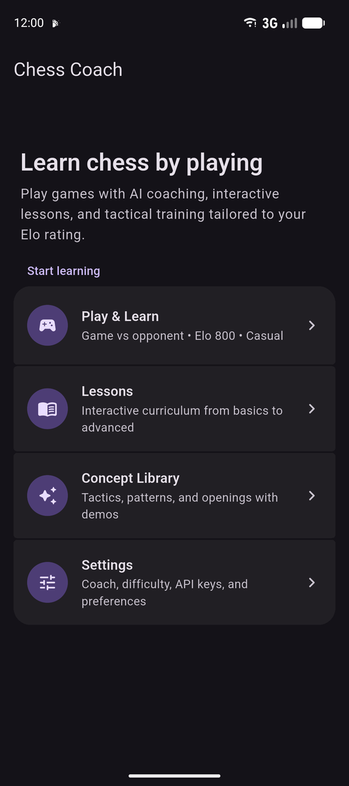
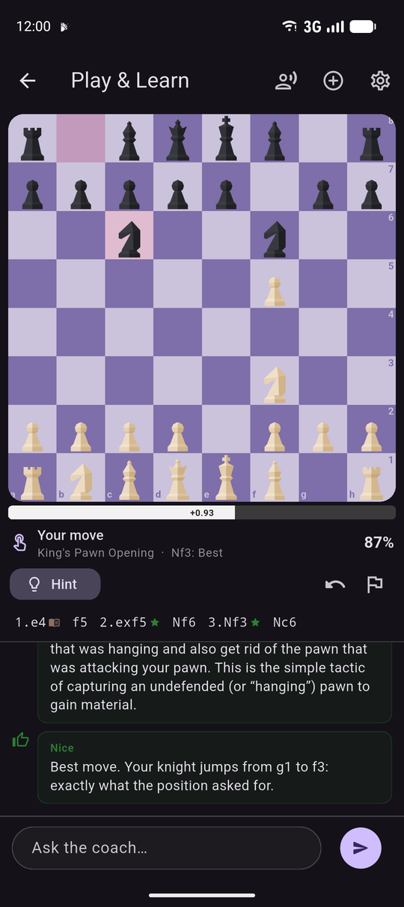
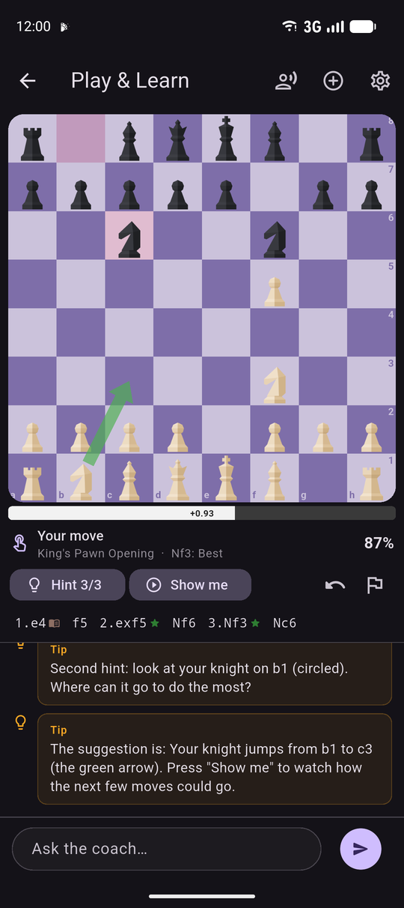
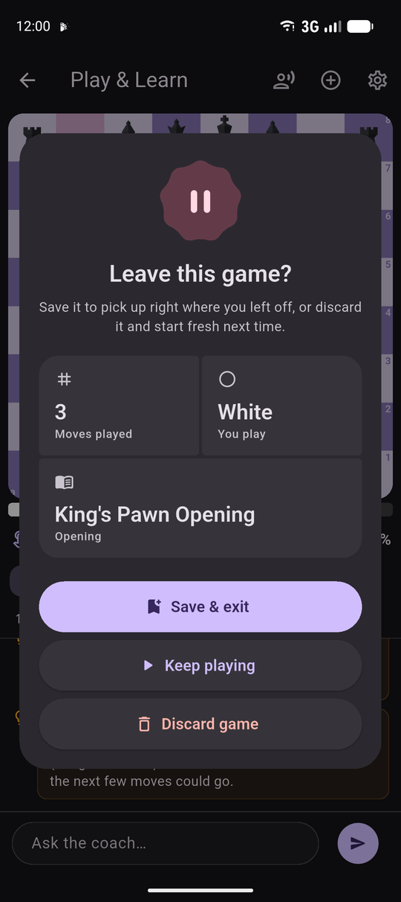
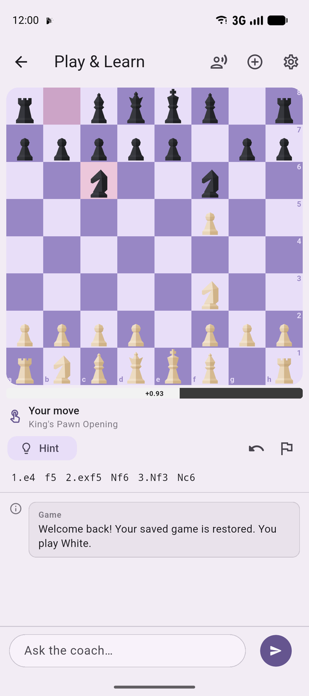
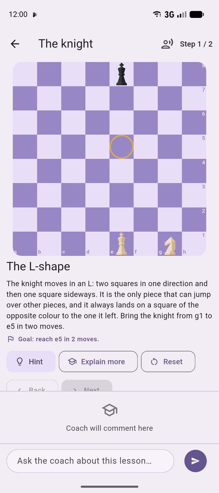
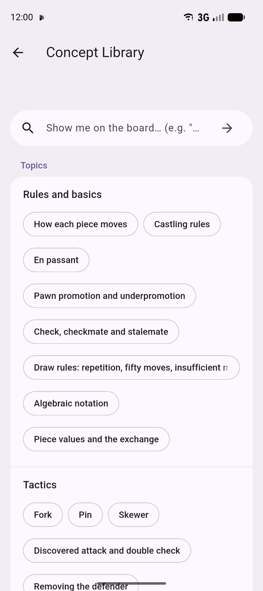
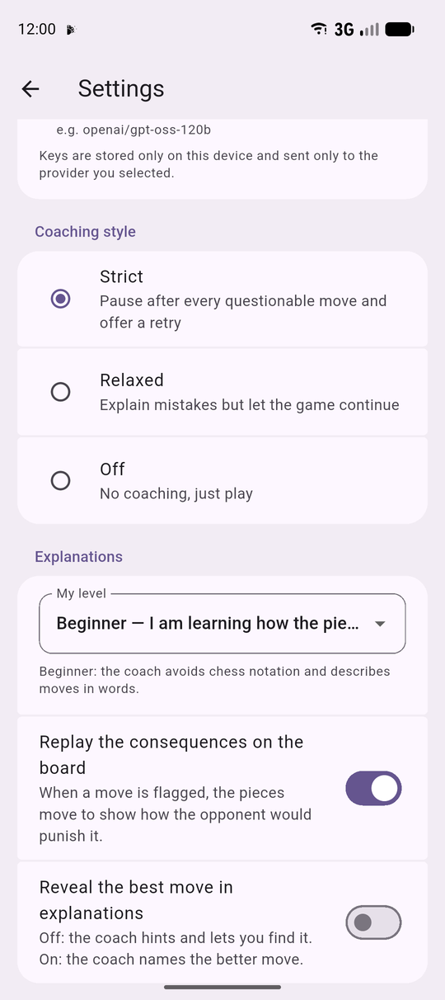

# Chess Coach

A Flutter chess app that teaches while you play. Every move you make is graded
by a built-in engine; when a better idea exists the AI coach explains the
principle behind it and lets you take the move back and try again.

## Download

Get the Android APK from the [latest release](https://github.com/rkprince101/chess-coach/releases/latest)
(Android 5.0+; allow installing from this source when prompted).

## Screenshots

<table>
  <tr>
    <td></td>
    <td></td>
    <td></td>
    <td></td>
  </tr>
  <tr>
    <td align="center">Home</td>
    <td align="center">Play &amp; Learn: every move graded</td>
    <td align="center">Three-level hints</td>
    <td align="center">Save or discard on exit</td>
  </tr>
  <tr>
    <td></td>
    <td></td>
    <td></td>
    <td></td>
  </tr>
  <tr>
    <td align="center">Resume a saved game</td>
    <td align="center">Interactive lessons</td>
    <td align="center">Concept Library</td>
    <td align="center">Settings</td>
  </tr>
</table>

Material 3 throughout: the board and highlights follow the theme color, the
faceted piece set is drawn in code, lists use segmented containers, and the
app runs edge-to-edge. The launcher icon follows Material You dynamic color on
Android 12+ and supports themed icons on Android 13+.

## What it does

- **Play & Learn** – a full game against an adjustable opponent (levels 1–8).
  After each of your moves the engine compares it with the best move. Book,
  Best, Good, Inaccuracy, Mistake and Blunder verdicts appear in the move list.
  In *Strict* mode a questionable move pauses the game: the coach explains what
  went wrong (hanging pieces, missed tactics, the opponent's punishing line,
  opening principles) and you choose **Take back & retry** or **Keep my move**.
- **Three-level hints** – concept → which piece → the move, drawn on the board.
- **Ask the coach anything** – free-form questions about the current position,
  with engine facts (evaluation, best line, hanging pieces) fed to the model so
  its answers stay grounded.
- **Live tips** – castling / en passant / promotion when they first become
  available, threats to your pieces, opening-principle reminders, opening names.
- **Post-game review** – accuracy score and a short coach summary of the
  lessons from your worst moves.
- **Lessons** – 32 interactive lessons (43 steps): how each piece moves, castling, en
  passant, promotion and underpromotion, check/mate/stalemate, piece values,
  opening principles, forks, pins, skewers, discovered attacks, back-rank and
  smothered mates, removing the defender, ladder / queen / rook mates, king and
  pawn endings, and guided tours of the Italian, Ruy Lopez, Queen's Gambit,
  London, Sicilian, French, Caro-Kann and King's Indian. Every position and
  line is verified by the test suite.
- **Concept Library** – 80+ topics (any tactic, mate pattern, strategic idea,
  endgame or opening) plus a free text box. The coach builds a *board demo*:
  2–4 positions with moves, arrows and captions, walked through move by move
  with a "Try it yourself" mode and follow-up questions. Every FEN and move
  the model proposes is validated with dartchess; illegal ones are dropped
  (and the model is asked once to fix them), verified lesson positions are
  offered to the model for matching topics, and a text explanation is the
  fallback.

The engine (`lib/engine/`) is a pure-Dart alpha-beta search with quiescence,
piece-square tables and a skill-level move picker. It runs in an isolate, needs
no native binaries, and works on Windows, Android, iOS, macOS, Linux and web.

## AI coach providers

Pick one in **Settings → AI coach**. Keys are stored on the device only.

| Provider | Notes |
|---|---|
| **Groq** – default | Key from console.groq.com. Default model `openai/gpt-oss-120b`; press **Fetch models** to list others. |
| **Grok (xAI)** | Key from console.x.ai. Type a model name or fetch the list. |
| **Claude** | Key from console.anthropic.com. `claude-opus-5` by default with adaptive thinking and server-side refusal fallbacks. |
| **Custom** | Any `/v1/chat/completions` server: OpenAI, OpenRouter, Ollama, LM Studio… |

Without a key the app still grades moves and gives engine-based explanations,
hints and lesson feedback; the AI adds the natural-language teaching.

## Beginner mode

With **My level = Beginner** (the default) the coach never uses bare notation:
"your knight jumps from f3 to e5 and captures a pawn" instead of "Nxe5". When
a move is flagged, the board **replays the opponent's punishing line** move by
move with red arrows and a plain-English caption (play / pause / step /
back to game). "Show a better idea" replays the engine's preferred line, and
the third hint offers "Show me" to animate the suggestion.

## Run

```sh
flutter pub get
flutter run -d windows     # or android / chrome / macos / linux
```

Release builds are noticeably stronger and faster for the engine:

```sh
flutter build windows
flutter build apk --release --split-per-abi   # Android; per-ABI APKs are ~25 MB
```

## Android notes

- Layout is aspect-aware: board above the panel in portrait (full width,
  horizontal eval bar, single-line move strip, compact controls); board beside
  the panel in landscape and on tablets. Widget tests pin the layouts at
  411×923 and 923×411 logical pixels and fail on any overflow.
- The engine runs in one long-lived worker isolate (no per-move isolate
  spawn), and coach text streams are coalesced to ~12 repaints/s.
- Haptics: light tick on your move, medium buzz when the coach flags one,
  heavy on game over.
- `INTERNET` permission is declared in the main manifest (the Flutter
  template only grants it to debug builds), so the AI coach works in release.
- `android/gradle.properties` disables Kotlin incremental compilation; the
  Kotlin daemon's incremental caches intermittently lock on Windows and fail
  `assembleRelease` otherwise.

## Test

```sh
flutter test
```

Covers the engine (mates, hanging pieces, forks, depth/time), every lesson
position and solution line, the streaming API clients (mocked), the play-and-
coach flow (grade → pause → retry), and the main screens.

## Project layout

```
lib/
  engine/      evaluator, alpha-beta search, isolate service
  coach/       LLM clients (Claude, OpenAI-compatible), prompts, board facts, opening book
  state/       GameController (play & learn loop), LessonController
  models/      move quality classification, lesson model
  data/        lesson curriculum and concept library
  services/    settings (shared_preferences)
  ui/          screens and widgets (board via chessground)
test/          engine, lessons, clients, game flow, widget smoke tests
```
